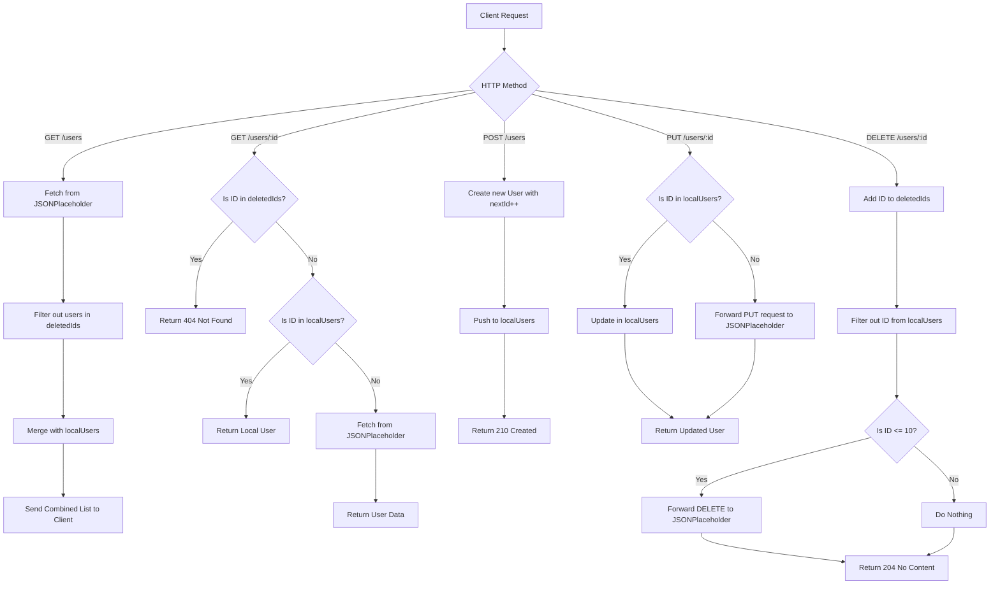

# Application Architecture & Logic Explanation

This document explains the structural flow and logic of the User Management Hub application, split into the **Express Server Backend** and the **Vanilla JS + Tailwind CSS Frontend**.

---

## 1. Server-Side Architecture (`server.js`)

The backend is built with Express and manages user profiles by combining live data from an external REST API ([JSONPlaceholder](https://jsonplaceholder.typicode.com/users)) with a local, in-memory database mock.

### Hybrid Mock Persistence
Since JSONPlaceholder is a mock REST API that does not actually persist changes (e.g., adding or deleting users will not be reflected in subsequent GET calls to JSONPlaceholder), the server implements a hybrid state management strategy:

- `localUsers`: An array storing newly created and modified users in memory.
- `deletedIds`: A `Set` tracking the IDs of users that have been deleted.
- `nextId`: An incrementing integer starting at `11` (to prevent conflicts with JSONPlaceholder's static IDs 1-10) assigned to new users.

---

## 2. Client-Side Lifecycle (`public/app.js`)

The frontend is a single-page app (SPA) that controls layout, CRUD, real-time validation, search filtering, and confirmation modals.

### State management
Two variables manage the frontend state:
- `users`: An array cache of the active list of users fetched from the server.
- `editingUserId`: An integer storing the ID of the user currently being edited (null when in "Create" mode).

### Operations and Flows

#### A. App Startup & Fetching
1. The DOM loads, triggering the `DOMContentLoaded` event listener.
2. `fetchUsers()` is invoked:
   - Temporarily displays animated loading skeletons.
   - Fetches users from `/users`.
   - Sorts the array descending by `id` so newly created users always sit at the top.
   - Invokes `renderUsers()`.
   - Updates the visual server status dot and banner (Online vs Offline).

#### B. Search & Filtering
- Listening to `input` events on the search box trigger `handleSearch()`.
- It performs a case-insensitive search locally across `name`, `username`, and `email` using the cached `users` array.
- This avoids repetitive network requests, rendering in real-time. If no results match, the empty state banner is displayed.

#### C. Forms: Validation, Creation, & Updates
- Clicking submit fires `handleFormSubmit()`.
- **Validation**: Fields are validated against basic empty states and email regex. If invalid, the field borders glow red, and error messages are made visible by removing their `hidden` classes. As the user corrects input, `input` event listeners restore the default borders and hide the warnings.
- **Request Routing**:
  - **Create Mode** (`editingUserId == null`): Sends a `POST` request to `/users` with body content. The newly returned user object is prepended to the `users` state array via `users.unshift()`.
  - **Edit Mode** (`editingUserId != null`): Sends a `PUT` request to `/users/:id`. The modified user object updates the local array via `.map()`.
- After successful operations, the form resets, inputs are cleared, and a toast is shown.

#### D. Custom Modal Confirmation
Instead of using standard browser `confirm()` boxes or duplicating event listeners dynamically, the app utilizes an overlay modal with a single callback pointer:
1. `deleteUser()` sets a global variable `activeDeleteCallback` to the delete API call closure.
2. The modal is revealed by removing the `hidden` class.
3. If the user clicks **Confirm**, `activeDeleteCallback()` runs, triggering the delete request, fade-out animation of the card, state update, and a toast alert.
4. Clicking **Cancel** or the backdrop hides the modal and resets `activeDeleteCallback` to `null`.

#### E. Toast Notifications
Toasts are generated programmatically without static CSS keyframe animations.
1. `showToast()` creates a new `div` with appropriate Tailwind styling (success green, error red, info blue).
2. It appends the toast to the bottom-right flex container.
3. Uses a browser reflow (`toast.offsetHeight`) followed by class swaps (`translate-y-2 opacity-0` $\rightarrow$ `translate-y-0 opacity-100`) to execute smooth CSS transitions.
4. Auto-dismiss occurs after 4 seconds using a standard `setTimeout` combined with a `transitionend` listener to destroy the DOM node cleanly.
